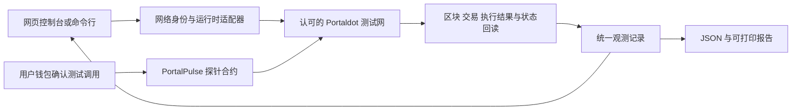

# PortalPulse 产品设计

设计日期：2026-10-09；只读增量更新：2026-10-14。赛道：Node Operations & Tooling。六模块目标保留，当前已实现本地身份观测、监控、CLI 和只读报告界面；M2A 已实现离线执行证据格式、六项校验与 CLI；真实执行采集、运行时解码、探针和网页执行流程仍待实施。交付状态见[时间线](roadmap.md)，验证条件见[验收标准](acceptance.md)。

## 当前离线执行增量

[离线执行格式](execution.md)独立于 M1 监测报告。校验 supplied facts 的网络、提交、纳入、执行、最终确认 ancestry 与状态回读；缺失前置证据不由后续记录补齐，明确失败保留异常。全部检查正常只产生 `evidenceComplete=true`，永久保持 offline、verifiedNetwork=false、writeAllowed=false、fullVerification=false。此增量只包含核心与 CLI，人工事实不构成真实 V3 部署、独立共识或完整产品验收。

## 当前只读界面

暖象牙底色、深墨文字、蓝色操作，采用来源横栏、双区块观察行、独立状态表与可展开证据时间线；系统中文无衬线与等宽数据字体，不加载外部字体或 UI 套件。桌面左侧证据 / 右侧只读配置，移动端单列。所有来源、别名及 RPC 响应均按文本渲染。

界面默认未连接；显式模拟 / 离线 / 实时只读模式。只读配置输入会停止旧会话，停止 / 卸载时关闭传输并中止请求，过期结果不能覆盖新会话。持续采集使用核心采样、保留和分析逻辑，导出原始采集时间。离线正常记录不代表当前网络正常，数据陈旧独立显示。未知身份与元数据保持未验证。JSON 校验失败会显示原因并保留之前有效记录，紧凑导入 / 导出同为 16 MiB 上限。打印样式保留来源、身份、状态、窗口、请求及时间线。

提交 2f1a91e 的实际浏览器已验证人工模拟、JSON 下载及独立核心导入、文件导入的离线标签、篡改拒绝并保留旧报告、390px 无横向溢出、print-media CSS 隐藏操作及配置，以及非 RPC 端点失败与 Stop 后离线状态。独立 Node 22.12 新目录复现也已完成。最终修复代码 49e6439 所在提交 6b24591 另通过独立 Node 22.12 新目录安装、188 项测试、类型检查、构建及 CLI demo / inspect；其实际浏览器复验覆盖空态、URL 形式 ID / 别名拒绝且未创建观测、模拟 6 条、非 RPC 失败显示未知且不沿用旧模拟成功数据，以及 Stop 后保留离线失败记录。本次未统计浏览器网络请求数量；下载 / 文件导入、390px 和打印 CSS 没有重跑，仍仅对应 2f1a91e。紧凑端点补正后的 c6bf4a0 又通过独立 Node 22.12 的 196 项测试、类型检查、构建及 CLI 复现；实际浏览器专项使用明确非 Portaldot 的人工本地 RPC 夹具，确认链名称 / system_chain 响应脱敏、缺少预期创世哈希时身份未验证，以及 Stop 后离线。后续 d58e695 将完整 URL token 比较放在字面替换前，保留无条件原文 fallback；独立 Node 22.12 全新目录的 200 项测试、类型检查、构建及 CLI 复现通过。其浏览器人工夹具确认重复路径等价 URL 的链名称及 system_chain 结果完全脱敏，身份保持未验证、Stop 后离线并可恢复模拟；该专项未重验控制台错误、下载 / 文件导入、窄屏或打印。完整键盘流、错误网络身份与真实超时的浏览器场景、打印 PDF 分页、公开托管和远端最终代码回读仍待验。

## 用户问题与首版流程

节点运营者需要判断端点是否可达、区块是否推进及最终确认是否停滞；DApp 开发者需要知道交易是否真的执行成功、状态是否正确保存。PortalPulse 将把这些阶段分开显示，并提供可复核证据。

官方 PDK / FailLens 已覆盖本地节点、账户、费用模拟、存储、事件与交易失败诊断。PortalPulse 保留持续运行观测、执行—最终确认—状态回读时间线及可导出复核记录的重点，不宣称这些基础工具能力独有；官方资料入口见[固定版本 V3 指南](https://github.com/ItsCogumellum/portaldot-v3-testnet-guide/tree/d671a32758573f4d9ab00d891b2dd6a48f36bcbb)。

1. 选择已经确认的 Portaldot 测试网配置，检查网络身份。
2. 查看 RPC 延迟、最新区块、已最终确认区块和最近错误。
3. 部署或选择探针合约，在钱包中确认一次更新测试序号的调用。
4. 观察提交、纳入区块、执行成功、最终确认、状态回读五个阶段。
5. 导出报告，由其他人按同一网络、合约、交易与区块重新核对。
6. 模拟端点断开或导入不匹配记录，显示异常或未验证。

探针只保存发起者对应的测试序号；每个发起者仅更新自己的序号。不转移、托管或质押资产。首版不接账户付费、短信或邮件告警、多链资产桥或用户私钥托管；告警先在控制台内显示。后续产品方向可考虑托管监测、历史留存和团队运行报告。

## 六个模块与交付边界

| 模块 | 计划行为与判定依据 |
|---|---|
| 网络身份与能力 | 显示配置来源、网络名称、创世哈希、运行时版本；区分主网、活动测试网和第三方开发节点。身份不符禁止写入，未知能力标未验证 |
| 节点监控 | 保存连接结果、请求耗时、区块高度变化与最终确认推进。无响应、数据陈旧及网络无推进分别显示，不能以空数据或旧缓存显示正常 |
| 执行回读 | 使用区块和当前交易定位执行结果，再核对探针状态。纳入但执行失败保持异常；最终确认和状态匹配后才完成全流程验证 |
| 探针合约 | 在主办方认可测试网上新部署，提供序号更新、读取和事件或等效回执，并至少完成一次真实更新及读回 |
| 报告与复核 | 导出时间、来源、身份、合约、交易、区块及状态结果；重新导入检查字段与摘要，不匹配不能通过 |
| 命令行工具 | 本机查询、持续监测和生成同结构报告；新环境可复现，超时、失败、未验证有明确退出结果 |

## 架构与接入能力

当前网页使用锁定的 TypeScript 7.0.2、React 19.3.0、Vite 8.3.4；命令行要求 Node.js >=22.12。网络适配器检查元数据头并归一化只读记录，界面和报告消费统一结果；完整 SCALE 解码与写入能力仍待后续核验。依赖来源和许可见 dependencies.md。

Substrate 保留为网络观测路径。官方固定版本 V3 指南已公布 Substrate / EVM 端点及 Solidity / Revive 工作流；Revive / Solidity 作为探针合约候选，待测试网恢复后核验网络身份、工具版本、编译器与运行时兼容性并实测部署和调用。首版不要求同时实现 legacy WASM 与 EVM；旧主网 rent-era Contracts / ink! 配置不能直接套用。跨 VM 可组合性尚未验证，分别调用两类合约也不能作为跨 VM 交互已经实现的证据。

H160 与原生账户映射以 `reviveApi.accountId` 实际查询为依据；任何原生到 EVM 账户注资前必须查询该映射，不能从已有 SS58 地址推定 EVM 部署者。Node Explorer 与 tPOTv3 原生精度 14 当前仅属指南公布内容。本次 V3 只读预检连接错误 / HTTP 502，未获得创世哈希、运行时、EVM 链 ID 响应或余额，尚未验证任何部署或能力成功，见[网络预检](network-preflight.md)。

公开 RPC 供网页读数据，签名调用由用户钱包确认。本机命令行可持续监测。浏览器若无法连接端点，应显示连接失败，并允许导入真实命令行记录；导入属于离线记录，始终显示采集时间、窗口及来源，不显示实时在线状态。

部署和写入前，必须确认主办方认可的 RPC、网络身份、测试币领取路径、浏览器或等效查询方式，以及合约开发版本。官方主网只读，写入流程明确拒绝已知主网创世哈希；运行时或身份不能确认时也不得启用写入。[网络预检](network-preflight.md)记录现有主网信息及证据局限。

## 统一记录与四类状态

| 记录类别 | 必需数据 |
|---|---|
| 每次观测 | 网络配置标识、配置来源、创世哈希、运行时版本、观测时间、端点别名、请求方法、耗时、结果状态 |
| 执行记录 | 虚拟机类型、合约地址、预期测试序号、交易哈希、区块哈希、交易索引、执行事件、最终确认依据、状态回读值、回读区块 |
| 导出记录 | 数据结构版本、采集起止时间、观察窗口、上述观测与执行记录、SHA-256 内容摘要 |

| 状态 | 含义 |
|---|---|
| 正常 | 对应检查已有充分且匹配的记录；完整执行验证还要求最终确认和状态读回匹配 |
| 异常 | 明确的超时、连接失败、执行失败、状态不符或陈旧告警 |
| 未验证 | 元数据缺失、无法解码、无法找到对应记录、能力未知或推进基线不足 |
| 采集中 | 当前检查或交易阶段尚在进行；不得展示完整验证已通过 |

超时、缺失元数据、无法解码及查不到的记录均不能转成成功。Substrate 交易复核使用区块哈希与交易哈希，结合交易索引和执行事件定位，不能假设存在通用交易索引查询接口。

## 采集与可信度

默认每 **10 秒**采集一次，每个请求 **8 秒**超时。界面始终显示观察窗口、采集起止时间与最后更新时间。观察至少**三个相邻区块变化**后建立区块间隔基线；之前不宣称区块推进正常。基线建立后，超过 **max(180 秒, 3 倍区块间隔中位数)** 没有观察到推进时报警。端点连接错误可自动重连；合约写入不能自动重签或重复发送。

浏览器与 CLI 报告同时受 **2,000 条观测**和 **16 MiB 完整紧凑 UTF-8 JSON**约束。超过任一上限时删除最早记录，保留最新窗口，并显示累计丢弃条数及实际起止时间。字节计算包含报告外层字段和摘要；直播内部历史同步为成功发布的保留窗口。导出使用版本化结构与 SHA-256 检测内容改动；保存量和观测时长不能等同于全天可用性。

CLI、网页与核心在 RPC 请求前共享配置校验，URL 形式的 ID / 别名被明确拒绝；报告移除配置端点及其 URL 规范化等价形式，保留无关公共来源链接。不可表示的节点数值保留为明确诊断文本和异常校验记录，不使后续正常观测无法发布。此脱敏只针对配置端点，不保证发现任意秘密。

摘要用于发现报告被改动，不能证明 RPC 提供者所报数据真实。单一 RPC 的信任局限始终保留；首版提供可复核记录，不宣称提供独立轻客户端共识证明。

产品适用的活动与赛道依据：[本届官方详情](https://dorahacks.io/hackathon/portaldot-hacker-house-2026/detail)、[官方赛道](https://dorahacks.io/hackathon/portaldot-hacker-house-2026/tracks)。
